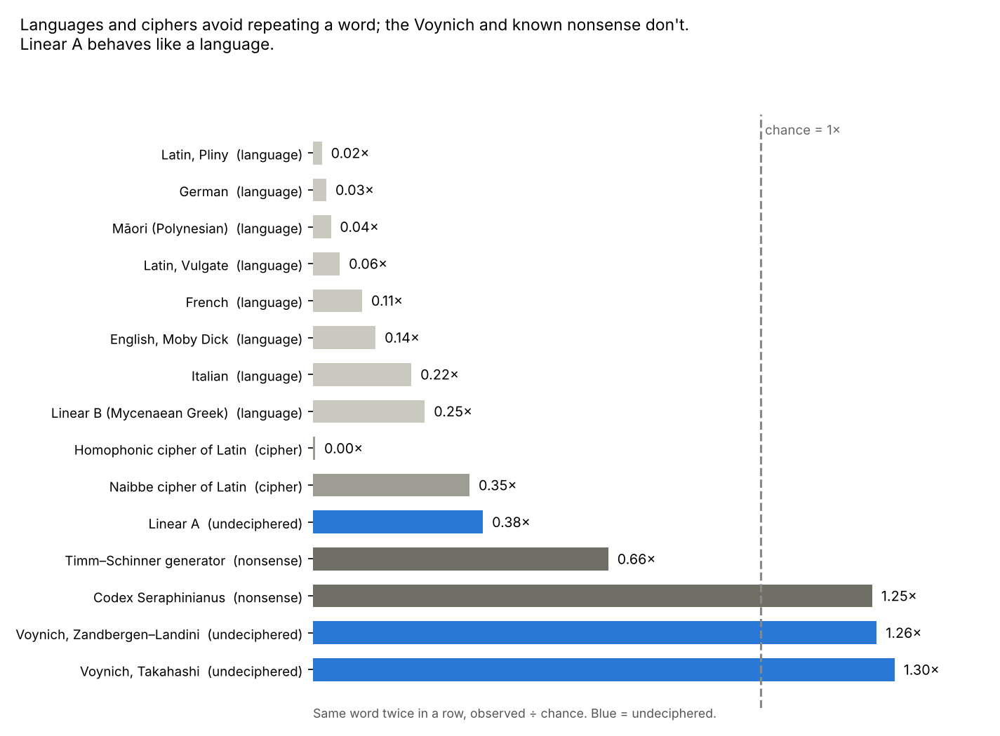

# The Untranslatable Archive

Clint Foster · November 2026 · contact: emmertfoster [at] yahoo [dot] com

A collection of texts nobody can read, each put through the same simple test, with the work shown.

## The test

Real languages almost never put the same word twice in a row. Grammar prevents it: nobody writes "the the." So in real text, back-to-back repeats are much rarer than they would be if the words were shuffled at random. A scribe who makes text up by copying his own recent words does the opposite and repeats more than chance.

Every real language tested sits far below chance, including Māori, a Polynesian language full of doubled syllables. So do both kinds of classic cipher. The Voynich sits above chance, next to a book known to be meaningless. Linear A, the undeciphered script of Minoan Crete, sits with the languages.

## The texts

| Text | Where from | Verdict so far | Page |
| --- | --- | --- | --- |
| **Voynich Manuscript** | Italy or the Alps, early 1400s | Behaves like nonsense from a scribe copying himself. Confirmed against the ink. | [voynich/](voynich/README.md) |
| **Rohonc Codex** | Hungary, 1500s | Shapes look slightly like Old Hungarian but don't carry its sounds. Leans toward a composing scribe; weaker evidence. | [rohonc/](rohonc/README.md) |
| **Rongorongo** | Easter Island, before the 1860s | Neither language-like nor copying-like. Sits at chance, unlike every language tested. | [rongorongo/](rongorongo/README.md) |
| **Linear A** | Minoan Crete, about 1800–1450 BC | Behaves like a language, just like its deciphered cousin Linear B. | [linear-a/](linear-a/README.md) |

Comparison texts (languages, ciphers, known nonsense) are described in [controls/](controls/README.md).

## How this was made

By Clint Foster working with Claude, an AI model made by Anthropic. Claude wrote and ran the code and wrote the text; Clint asked the questions and pushed back on weak results. Every number comes from code in this repository run on public data, and the mistakes and dead ends are recorded rather than hidden. The full story is in [NOTEBOOK.md](NOTEBOOK.md). Check the work before trusting it.
