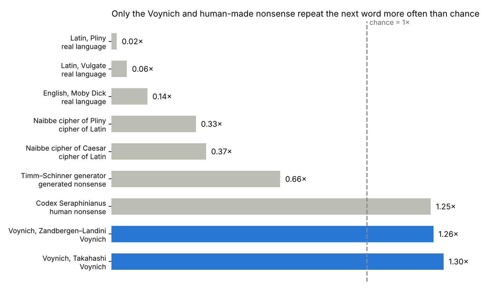

# The Voynich Manuscript repeats itself like nonsense, not like a language

*Part of [the Untranslatable Archive](../README.md).*

Clint Foster · November 2026 · contact: emmertfoster [at] yahoo [dot] com

**What we asked:** Is the Voynich Manuscript's text written in a real language (maybe in code), or was it made up by a scribe copying and changing his own words as he went?

**The key test:** Real languages almost never put the same word twice in a row. Grammar prevents it. You don't write "the the." So in real text, back-to-back repeats are much rarer than they'd be if the words were shuffled randomly. We checked this in Latin, English, Italian, German and French, and all five avoid repeats. The Voynich does the opposite: it repeats words back-to-back *more* often than random shuffling would.

Each bar shows how often a text puts the same word twice in a row, compared with random shuffling (the dashed line). Below the line means the text avoids repeats; above means it seeks them out.

## What we found

- **It's in the ink, not the typing.** Most Voynich research uses typed-up versions of the text. We matched about 4,700 typed words to photos of the actual pages and confirmed the repeats are really there in the scribe's handwriting.
- **The best "it's a code" idea fails this test.** A published cipher that turns Latin into Voynich-looking text still avoids repeats, the way Latin does. The Voynich doesn't.
- **Known nonsense behaves the same way.** The *Codex Seraphinianus*, a 1981 book whose author says its writing means nothing, repeats words just like the Voynich.
- **The scribe was copying himself.** Words tend to resemble the words just before them on the same line and in the few lines above. That's what you'd expect if he made up each word by copying a recent one and changing a letter or two.

## What it means

The simplest explanation is that the Voynich text was made up word by word by a scribe copying his own recent writing, not written in a language. This doesn't prove the book means nothing, but it rules out plain language and the leading code theory. Earlier researchers already found the repetition. What's new here is the check against the ink itself, plus the two comparison books.

The numbers, methods, sources and everything that went wrong are in [DETAILS.md](DETAILS.md).

## How this was made

This analysis was done in one evening as a conversation between Clint Foster and Claude, an AI model made by Anthropic. Claude wrote and ran the code, and wrote the text; Clint directed the questions and pushed back on weak results. Every number comes from code in this repository run on public data. The dead ends and corrected mistakes are listed in DETAILS.md rather than hidden. Check the work before trusting it.

## What's in this repository

- [`../NOTEBOOK.md`](../NOTEBOOK.md): the story of how this came together, in order, dead ends included.
- `DETAILS.md`: methods, all results tables, prior work, failures, sources.
- `data/voynich_recipes_virgin_K80.tsv`: a machine transcription of 20 recipe pages (f103r–f116r, without f111r/v) built from the scans with no human reading, in an invented 80-symbol alphabet. Columns: page, line, word, symbols.
- `data/syllabary_K80.png`: eight real examples of each invented symbol, cut from the scans.
- `figures/`: the chart above.
- `code/`: the analysis scripts as run. File paths point to the original working folders and need adjusting; the input data comes from the sources listed in DETAILS.md and is not redistributed here.
